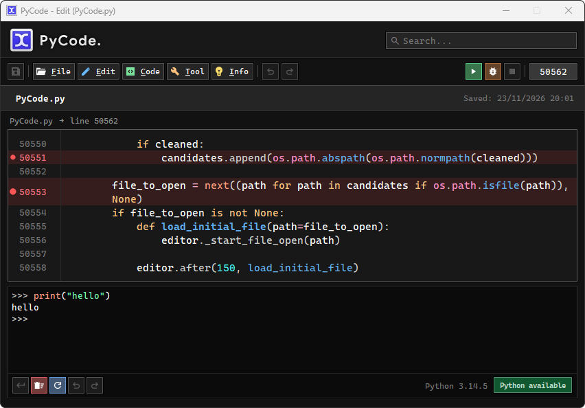
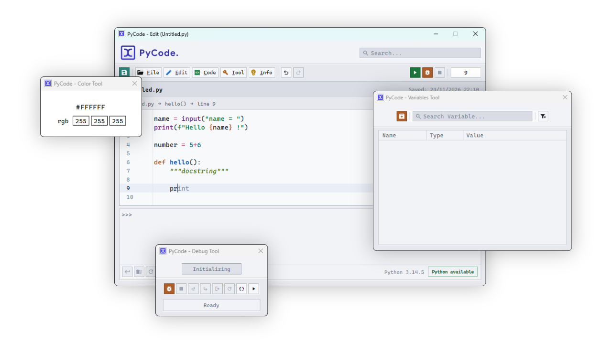

# PyCode

<p align="center">
  <strong>A modern desktop Python Editor</strong><br />
  Built with Python and Tkinter by Milan Feigna.
</p>

<p align="center">
  
</p>

PyCode is a lightweight desktop Python IDE that brings together a code editor, a visual step-by-step debugger, a live variable inspector, and integrated consoles. Its interface includes dark, light, and system themes, with high-DPI scaling.

---

## Features

### Code editor

- **Syntax highlighting** for Python syntax, docstrings, f-strings, `.format()` strings, regular expressions, and hexadecimal color literals (`#RRGGBB`).
- **Inline autocomplete** with context-aware ghost-text suggestions for variables, functions, classes, imported modules, and keyword arguments. Use `Tab` to cycle through suggestions and `Enter` to accept one.
- **Editing helpers**, including automatic closing of brackets and quotes, line commenting (`Ctrl+/`), quick colon + newline (`Ctrl+:`), symbol occurrence highlighting, and matching-bracket indicators.
- **Navigation and search** with a live search bar and match counter (`Ctrl+F`), breadcrumbs (`File → Class → Function → Line`), and go-to-line (`Ctrl+L`).
- **Large-file support** using background tokenization and viewport-based rendering to keep large scripts responsive.

<p align="center">
  
</p>

### Visual debugger

- **Breakpoints** directly in the editor gutter or with `Ctrl+Alt+B`.
- **Execution controls:** Step Over, Step Into, Step Out, Continue, and Restart.
- **Inline evaluation** showing expression values, loop iterations, and branch outcomes while debugging.
- **Interactive tracebacks:** click a file path or line number in an error traceback to jump to that location in the editor.

### Consoles and built-in tools

- **Python console:** run the current script (`Ctrl+R`), selected code (`Ctrl+Shift+Enter`), or current line (`Ctrl+Enter`) in an isolated worker process with ANSI color support.
- **Root Console:** a dedicated execution window with size presets (`x1`, `x2`, `x3`, and fullscreen).
- **Variables Tool (`Ctrl+Shift+V`):** inspect variables, types, container lengths, and values in real time. It includes search, type filtering, and export to `.pdf`, `.xlsx`, or `.txt`.
- **Integrated Terminal (`Ctrl+T`):** a built-in system shell with command history and syntax coloring.
- **Color Tool (`Ctrl+K`):** convert and inspect HEX and RGB colors.

<p align="center">
  
</p>

### Interface and customization

- **Three themes:** Dark (`#0`), Light (`#F`), and System (`#S`).
- **Typography and icons:** embedded Cascadia Mono font and Material Symbols icons.
- **High-DPI support:** automatic interface scaling.

---

## Getting started

### Requirements

- **Python 3.10 or newer.**
- **Tkinter**, which is included with many Python distributions. On some Linux distributions, it may need to be installed separately.
- Optional packages:
  - `Pillow` for icon rasterization.
  - `ReportLab` for PDF export.

Install the optional packages with:

```bash
python -m pip install pillow reportlab
```

### Run PyCode from source

Clone the repository and launch the application:

```bash
git clone https://github.com/MilanFeigna/PyCode.git
cd PyCode
python PyCode.py
```

---

## Current version

**PyCode `v6.97`**

See the repository's [commit history](https://github.com/MilanFeigna/PyCode/commits/main) for the latest changes.

## Code signing

Free code signing is provided by [SignPath.io](https://signpath.io), with a certificate from the [SignPath Foundation](https://signpath.org/).

## License

PyCode is distributed under the **MIT License**. See the [LICENCE](LICENSE) file for details.

## Author

**Milan Feigna**

Developed by Milan Feigna, with AI assistance.

---

<p align="center">
  <a href="https://github.com/MilanFeigna/PyCode">GitHub repository</a>
</p>
